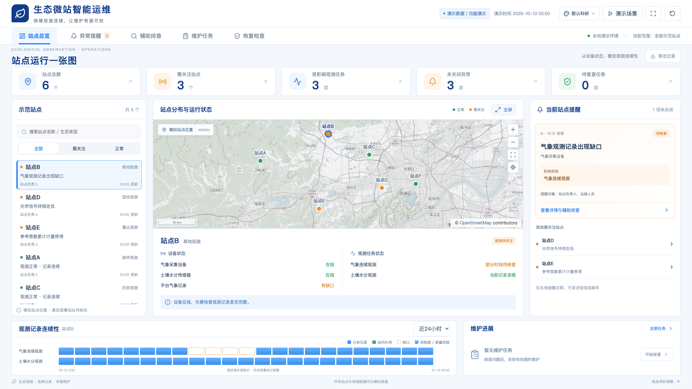

# 生态微站智能运维

蓝白生态科研风格的本地交互演示，基于上一级《演示文稿419-20261012.pptx》。原PPT保留不变。七页按幻灯片实际图片引用关系提取并逐页检查；参考图片不作为网页主体。



## 启动

需要 Node.js 20.19+ 或 22.12+。

```sh
git clone https://github.com/liuchuang164/ecostation-ops-demo.git
cd ecostation-ops-demo
npm ci
npm run dev
```

已有本地项目时，直接进入项目目录后执行 `npm ci`、`npm run dev` 即可。原始PPT和开发时提取的整页参考图不随代码仓库发布，运行所需资源已包含在 `public/` 中。

打开终端打印的地址，默认 http://127.0.0.1:5173 。服务仅监听本机，没有对外部署。`npm run build` 构建静态站点。图标、设备局部图与本地简化地理底图随项目保存。在线OpenStreetMap底图无需密钥，失败后降级本地OSM简图。

## 目录

- `src/model.ts`：统一站点、设备、观测、异常、证据、任务、复查及操作日志；汇总与状态流转。
- `src/stationCoordinates.ts`：固定模拟WGS84坐标、旧本地状态迁移与坐标验证。
- `src/StationMap.tsx`：OpenLayers二维GIS，稳定ID点位、列表联动、浮层、缩放、定位、范围适配及全屏。
- `src/mapBasemap.ts`、`src/stationMap.css`：底图配置、明确投影与地图样式。
- `src/main.tsx`、`src/style.css`：原五个业务工作区与蓝白响应式布局。
- `public/maps/hangzhou-west.geojson`：实际OSM几何提取的本地水面、河流、主路与地名，保留源对象ID。
- `public/assets/optical-window.png`：PPT第5页无文字区域的设备参考局部图，非现场核查照片。
- `tests/model.test.ts`、`tests/coordinates.test.ts`：业务状态、指标去重、坐标校验与迁移。
- `tests/browser.mjs`：三条完整业务路线浏览器验收。
- `tests/gis-browser.mjs`：真实投影、点位稳定、筛选、全屏、旧记录保留、缺失坐标及断网降级验收。
- `screenshots/`：实际运行截图与检查结果。
- `DEMO_GUIDE.md`：领导现场操作路线。
- `GIS_COORDINATES.md`：点位核对表、来源与真实站址替换步骤。
- `GIS_BASEMAP_SOURCE.md`：地理数据来源、ODbL许可和提取方法。

## 模拟业务状态

6个虚构站点，14个设备与观测任务，每任务24个小时记录，3个主要异常。观测记录日2026-10-12，初始演示时刻2026-10-13 00:00。保存操作推进5分钟，提交复查额外推进90分钟模拟观察时间；不使用系统实时时钟。

汇总来自统一实体：需关注站点按未关闭异常去重，影响观测按任务ID去重。设备连接、记录完整性、质量状态、异常状态、任务阶段和复查结果分别保存。B的08:00–12:00缺口、D的07:00后历史质量风险、E的累计平台期均保留明确含义。

保存人员和安排依据之后才可开始维护；有处理记录才能提交复查；每次复查重新待检。未通过立即回到处理中，需要新增处理记录才能再次复查。全部必需项目通过且保存复查范围才可关闭。

补传要求最近一次站内原始记录核查为“记录完整”，且勾选确认实际保存记录；否则缺口保留。补传为绿色、质量仍待检查。事件关闭不批量清除历史风险。两个设备维护后模拟曲线只在复查完成后表现恢复，补水瞬间不跳升，不补回未测蒸散量。

## 地图与坐标

“站点分布与运行状态”使用OpenLayers，输入WGS84地理度数，坐标顺序 `[经度, 纬度]`，显示投影 `EPSG:3857`。点位按稳定站点ID关联统一数据，绿色/橙色来自当前业务状态，蓝色外圈单独表示选中。普通状态刷新不重建地图或自动重置视野。

当前站点A–F原本只有页面百分比，没有实际站址依据。现补充固定模拟坐标，明确显示“模拟站点位置”。真实部署位置需要替换为核实后的站址；表格与替换方法见 [GIS_COORDINATES.md](GIS_COORDINATES.md)。

旧版 `ecostation-demo-v1` 按ID补齐坐标，不清空任务、证据、日志、异常或观测。已有明确坐标、真实标识、显式缺失和部分坐标字段不被覆盖。真实站点缺失坐标保留列表，暂不落点。GCJ-02、BD-09或未知坐标系会明确提示需核实转换，不能直接当成WGS84。

拖动/滚轮和加减按钮可调整视野。“查看全部站点”只适配筛选后有效点位，单点最大适配缩放为12。“定位当前站点”展示浮层。点击左侧或地图共用一个选中站点状态；筛选隐藏已选点时保留选择并提示，不偷偷改选。全屏/返回保持地图实例与选择，并更新容器尺寸。

## 底图配置

默认在线OSM标准XYZ：`https://tile.openstreetmap.org/{z}/{x}/{y}.png`。仅按当前视野加载，不批量缓存。保留OpenStreetMap来源标注。在线失败或8秒未完成加载，显示失败原因与重试按钮，并使用本地真实OSM矢量简图。

本地简图覆盖杭州西部约119.35–120.4°E、30.0–30.6°N，含773个真实地理要素。仅保留简化水面/河流/主路/地名，覆盖范围外无详细地物。数据EPSG:4326经由GeoJSON明确一次转换到EPSG:3857。来源与许可见 [GIS_BASEMAP_SOURCE.md](GIS_BASEMAP_SOURCE.md)。

复制 `.env.example` 为 `.env.local`，修改后重启Vite。现场无网络可使用：

```dotenv
VITE_BASEMAP_MODE=local
```

默认模式为 `online`。可用 `VITE_BASEMAP_URL` 和 `VITE_BASEMAP_ATTRIBUTION` 替换兼容EPSG:3857且与WGS84基准一致的XYZ服务。不能将GCJ-02/BD-09底图直接混用。若其他服务需要密钥，仅在 `.env.local` 配置实际提供的密钥；Vite前端变量会被浏览器读取。本项目默认方案无需密钥，未采用当前需要密钥的CARTO服务。

## 保存、导出和重置

当前浏览器localStorage保存进度，键为 `ecostation-demo-v1`。场景切换保留其他事件。顶部“导出记录”下载含模拟说明的JSON，包含坐标、业务实体、核查、维护、复查及角色时间日志。“重置演示”需确认后恢复初始状态；地图升级本身不执行重置。不同浏览器来源或端口的进度互相独立。

## 检查与限制

```sh
npm run build
npm test
# 沙盒限制tsx IPC时使用等价命令
node --import tsx --test tests/*.test.ts
# 先启动dev，再使用本机Chrome
node --import tsx tests/gis-browser.mjs
node tests/browser.mjs
```

TypeScript和生产构建成功，9项业务与坐标测试通过。真实Chrome已验证三条业务闭环、坐标投影、平移缩放与全屏不漂移、统一选中、D的橙色状态与蓝色外圈、空筛选、缺失/未知坐标系、旧维护记录保留、在线加载和强制断网降级。1920×1080、2560×1440、3840×2160首页核心内容一屏可见；1366×768纵向滚动。详见 `CHECKS.md` 和 `screenshots/gis-validation.json`。

本项目是前端模拟演示，没有生产后台、真实设备接入、真实通知或真实账号权限。真实站址与原始测量坐标尚待提供。在线底图受网络和服务可用性影响，本地简图只覆盖示范区域。设备曲线及质量结论为模拟样本和手动演示检查，不能推导真实试点成效。JSON导出不提供CSV。构建有图表包体积提示，非构建失败。

## 颜色风格

右上角调色板按钮提供三种颜色风格：默认科研（原蓝白）、金属灰（浅银灰与石墨文字）、科技蓝（深蓝层次与淡蓝文字）。配色覆盖五个工作区、表单、弹窗、记录条、GIS底图/标记/浮层及ECharts曲线和坐标轴。正常绿色与需关注橙色语义保持一致。

偏好单独保存在 `ecostation-ops-theme-v1`，刷新后保留；不修改业务状态、当前站点或地图视野。“重置演示”仅重置模拟业务，不重置颜色偏好。主题定义位于 `src/themes.css`，控制与持久化位于 `src/ThemePicker.tsx` 和 `src/theme.ts`。默认无偏好时使用现有蓝白风格。
